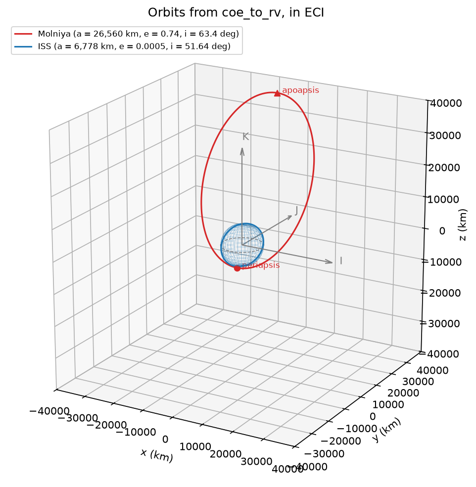

# orbit-state-vector-toolkit

Python tools for describing Earth orbits from their classical orbital elements, analysing an orbit from its state vector (position and velocity), and converting between the two. Built in stages over Week 2 of a flight dynamics study plan; this README grows with the repo.

| Part | Tool | Input → output | Status |
|---|---|---|---|
| 1 | Orbit Describer (`describe.py`) | elements → plain-English description | complete |
| 2 | Vector invariants (`vectors.py`) | state vector → h, n, e vector, a, i | complete, 23 tests |
| 3 | Forward conversion (`conversions.py`) | elements → state vector | complete, 35 tests |
| 4 | Reverse conversion (`conversions.py`, `roundtrip.py`) | state vector → elements | complete, 52 tests |
| 5 | Kepler solver and elements explorer | | next |

## Repository structure

```
orbit-state-vector-toolkit/
├── describe.py              Part 1: orbit describer
├── vectors.py               Part 2: vector invariants from (r, v)
├── conversions.py           Parts 3-4: coe_to_rv and rv_to_coe
├── plot_orbit.py            Part 3: 3D plot of orbits from coe_to_rv
├── roundtrip.py             Part 4: round-trip every orbit and report the max error
├── pytest.ini               pytest configuration
├── .gitignore               ignores Python cache folders
├── data/
│   ├── orbits.csv           Part 1 input: 6 real orbit types + 2 invalid rows
│   └── states.csv           Part 2 input: 3 test states + 2 invalid rows
├── output/
│   ├── descriptions.csv     Part 1 results
│   ├── skipped.txt          Part 1 rejected rows
│   ├── invariants.csv       Part 2 results
│   ├── states_skipped.txt   Part 2 rejected rows
│   ├── states_from_elements.csv   Part 3 results (same format as data/states.csv)
│   └── elements_skipped.txt       Part 3 rejected rows
├── figures/
│   └── orbit_3d.png         Part 3: Molniya and ISS orbits in ECI
└── tests/
    ├── test_vectors.py      23 tests for Part 2
    ├── test_conversions.py  35 tests for Part 3
    └── test_roundtrip.py    52 tests for Part 4
```

## Setup and run

Requires Python 3 with NumPy (Parts 2–4), matplotlib (the plot) and pytest (tests). Part 1 uses the standard library only.

```
git clone git@github.com:dkumar2016/orbit-state-vector-toolkit.git
cd orbit-state-vector-toolkit

python describe.py     # Part 1: describe the orbits in data/orbits.csv
python vectors.py      # Part 2: invariants of the states in data/states.csv
python conversions.py  # Part 3: convert the orbits in data/orbits.csv to state vectors
python plot_orbit.py   # Part 3: 3D plot, saved to figures/orbit_3d.png
python roundtrip.py    # Part 4: elements -> state -> elements, with the max error
pytest -v              # run all 110 tests
```

The programs follow the same pipeline: **read** a CSV, **process** each valid row once, **output** to the console and to files. Bad rows are skipped with their line number and a reason; they never stop the program.

## Conventions

| | |
|---|---|
| Frame | Earth-centred inertial (ECI): I towards the vernal equinox (♈), K towards the north pole, J completing the right-handed set |
| Units | km, km/s, degrees. Public functions take degrees; radians are used only inside, converted once at the edge |
| Constants | μ⊕ = 398,600.4418 km³/s², R⊕ = 6,378.137 km |
| Model | two-body (Keplerian): no J2, drag or other perturbations |

---

## Part 1: Orbit Describer

`describe.py` reads classical orbital elements, rejects physically impossible orbits with a reason, and describes each valid orbit in one plain-English sentence:

```
Molniya: highly elliptical HEO, altitude 528-39,836 km, prograde at 63.4 deg, period 11.97 h (718.0 min). Ground track reaches +/-63.4 deg latitude.
```

### Input: `data/orbits.csv`

| Column | Element | Units |
|---|---|---|
| `name` | orbit label | text |
| `a_km` | semi-major axis *a* | km |
| `e` | eccentricity *e* | – |
| `i_deg` | inclination *i* | deg |
| `raan_deg` | right ascension of the ascending node *Ω* | deg |
| `argp_deg` | argument of perigee *ω* | deg |
| `nu_deg` | true anomaly *ν* | deg |

Six real orbit types (ISS, GPS, GEO, Molniya, sun-synchronous, retrograde LEO) and two deliberately invalid rows. Values are representative of each orbit type, not current tracking data.

### Pipeline

```
read_orbits      CSV row  -> Elements      (validated on creation, or skipped with a reason)
summarize        Elements -> summary dict  (every label and derived value, computed once)
describe / write summary  -> sentence, descriptions.csv
```

The sentence and the CSV row are both built from the same summary, so they can't disagree.

### Validation

| Check | Why |
|---|---|
| 0 ≤ e < 1 | e ≥ 1 is a parabolic or hyperbolic trajectory, not a closed orbit |
| periapsis radius a(1 − e) > R⊕ | the orbit would pass through the Earth |
| 0 ≤ i ≤ 180° | inclination is only defined on this range |

Ω, ω and ν are wrapped into [0°, 360°). Non-numeric values and missing columns are also skipped with a reason.

### Classification rules

| Label | Rule |
|---|---|
| Shape | circular e < 0.001 · near-circular < 0.1 · elliptical < 0.5 · highly elliptical ≥ 0.5 |
| Regime | HEO if e ≥ 0.5; otherwise by mean altitude a − R⊕: LEO ≤ 2,000 km · GEO within ±200 km of 35,786 km · MEO below GEO · Beyond GEO |
| Inclination | equatorial < 5° · prograde < 85° · polar 85–95° · retrograde ≤ 175° · retrograde equatorial; LEO at 96–102° flagged as sun-synchronous band |
| Max latitude | i for prograde, 180° − i for retrograde |

HEO is checked first: Molniya's mean altitude falls in the MEO range, but its altitude swings from 528 to 39,836 km, so "MEO" would misdescribe it.

### Results

| Orbit | Shape | Regime | Inclination class | Perigee–apogee alt (km) | Period |
|---|---|---|---|---|---|
| ISS | circular | LEO | prograde | 396–403 | 92.6 min |
| GPS IIF | near-circular | MEO | prograde | 19,916–20,448 | 11.97 h |
| GOES-16 | circular | GEO | equatorial | 35,782–35,790 | 23.93 h |
| Molniya | highly elliptical | HEO | prograde | 528–39,836 | 11.97 h |
| Sentinel-2A | circular | LEO | retrograde (SSO band) | 785–787 | 100.6 min |
| Retrograde LEO | near-circular | LEO | retrograde | 431–569 | 94.6 min |

Skipped: line 8 (e = 1.2, not a closed orbit) and line 9 (periapsis 3,500 km, inside the Earth).

### Checks on the results

- **GEO period = one sidereal day:** GOES-16's 1436.1 min (23.93 h) is why it stays over one longitude.
- **Period depends only on a:** GPS and Molniya share a = 26,560 km and so the same 11.97 h period, despite very different shapes.
- **ISS:** period 92.6 min and altitude around 400 km match published values.

---

## Part 2: Vector invariants from a state vector

`vectors.py` takes a state vector — position **r** and velocity **v** in ECI at an epoch — and computes the vectors and scalars that define the orbit. These are the building blocks for converting a state vector into orbital elements (Part 4).

### What it computes

| Quantity | Formula | Gives |
|---|---|---|
| angular momentum **h** | **r** × **v** | the orbit plane; i = angle between **K** and **h** |
| node vector **n** | **K** × **h** | direction of the ascending node (Ω in Part 4) |
| eccentricity vector **e** | [(v² − μ/r) **r** − (**r·v**) **v**] / μ | points to periapsis; its length is e |
| specific energy ε | v²/2 − μ/r | a = −μ / (2ε) |
| **r · v** | dot product | climbing (> 0) or falling (< 0); the quadrant check for ν |

It also flags the two singular cases, where some elements are undefined:

| Flag | Condition | Element lost |
|---|---|---|
| `circular` | \|**e**\| < 10⁻¹⁰ | ω (no periapsis) |
| `equatorial` | \|**n**\| < 10⁻¹⁰ | Ω (no node) |

### Input: `data/states.csv`

```
name,epoch_utc,x_km,y_km,z_km,vx_km_s,vy_km_s,vz_km_s
```

Every state carries an **epoch**: a state vector is only valid at one instant, so a file without times would be incomplete.

| State | r (km) | v (km/s) | Purpose |
|---|---|---|---|
| ISS-like | [6778, 0, 0] | [0, 4.759, 6.013] | matches a hand calculation |
| Equatorial circular | [7000, 0, 0] | [0, √(μ/7000), 0] | both singular cases at once |
| Eccentric | [7000, 0, 0] | [0, 7.4511, 4.3019] | periapsis of an orbit with e = 0.3, i = 30°, built from vis-viva |
| Escape | [7000, 0, 0] | [0, 11.0, 0] | **invalid**: above escape speed, ε > 0 |
| Inside Earth | [6000, 0, 0] | [0, 8.0, 0] | **invalid**: \|r\| < R⊕ |

The test velocities are stored at full double precision. Rounding the circular case to six decimals gives e ≈ 8 × 10⁻⁸, which is a genuinely (slightly) elliptical orbit and is correctly *not* flagged circular.

### Pipeline

```
read_states      CSV row -> (line, name, epoch, r, v)   (bad numbers skipped)
invariants       r, v    -> dict                         (rejects non-orbits; all values computed once)
output           dict    -> console table, invariants.csv
```

Reading only converts numbers; `invariants` decides whether a state is a real orbit. Rejections from both stages are reported together, in file order.

### Results

```
Read 5 rows from states.csv: 3 processed, 2 skipped

Name                  |h| km2/s         e      a km   i deg  circular equatorial
ISS-like                51976.4  0.000063    6777.6   51.64        no         no
Equatorial circular     52822.4  0.000000    7000.0    0.00       yes        yes
Eccentric               60226.8  0.300000   10000.0   30.00        no         no

Skipped rows:
  line 5  Escape: not a closed orbit: energy 3.557 km2/s2 >= 0
  line 6  Inside Earth: position 6000.0 km is inside the Earth
```

| | ISS-like | Equatorial circular | Eccentric |
|---|---|---|---|
| **h** | [0, −40,756.1, 32,256.5] | [0, 0, 52,822.4] | [0, −30,113.4, 52,157.9] |
| **n** | [40,756.1, 0, 0] | [0, 0, 0] | [30,113.4, 0, 0] |
| **e** vector | [−6.3 × 10⁻⁵, 0, 0] | ~0 | [0.3, 0, 0] |
| ε (km²/s²) | −29.406 | −28.471 | −19.930 |

`output/invariants.csv` holds every value, with vectors split into x, y, z columns.

### What the results show

- **The hand calculation is reproduced exactly** (**h**, i = 51.64°, a = 6,777.6 km).
- **The ISS-like state is at apoapsis, not on a circle.** Its velocity, rounded to 3 decimals, is 0.24 m/s below circular speed. That makes e = 6.3 × 10⁻⁵, with **e** pointing *opposite* **r**: the satellite is at its highest point. The direction of a tiny eccentricity vector is set by rounding, which is why ω is unreliable for near-circular orbits and the argument of latitude (ω + ν) is used instead.
- **The eccentric state's e vector points along r**, confirming it sits at periapsis, as it was built.
- **The equatorial circular state loses both n and e**, so Ω and ω are both undefined; Part 4 handles this.

### Tests

`pytest -v` runs **23 tests** in four groups:

| Group | Tests | What it checks |
|---|---|---|
| Known answers | 5 | ISS **h**, i and **n** against the hand calculation; eccentric e = 0.3, a = 10,000 km, i = 30°; **e** points to periapsis |
| Edge cases | 5 | circular and equatorial flags set (and *not* set for the ISS); escape and inside-Earth states rejected with the right message |
| Identities | 12 (4 × 3 states) | **h** ⊥ **r** and **v**; **e** lies in the orbit plane; \|h\| = √(μa(1 − e²)); Lagrange's identity h² + (r·v)² = r²v² |
| File reading | 1 | name, epoch and line number kept; a typo row skipped |

The identity tests hold for any orbit, so they check the maths itself, not just the cases written down. Writing them found one real bug: `is_zero` returned NumPy's `bool_`, which is not Python's `True` (`np.bool_(True) is True` is `False`). It now returns a plain `bool`.

---

## Part 3: Elements → state vector

`conversions.py` provides `coe_to_rv(a_km, e, i_deg, raan_deg, argp_deg, nu_deg)`, which returns the position **r** (km) and velocity **v** (km/s) in ECI. Run as a program, it converts every orbit in `data/orbits.csv`.

### Method

1. **Perifocal frame (PQW).** P points to periapsis, Q is 90° ahead in the orbit plane, W is along **h**. In this frame the orbit is flat:

   ```
   p     = a (1 − e²)                          semi-latus rectum
   r_pqw = p / (1 + e cos ν) · [cos ν, sin ν, 0]
   v_pqw = √(μ/p) · [−sin ν, e + cos ν, 0]
   ```

2. **Rotate into ECI** with three rotations (a 3-1-3 sequence), one per orientation element:

   ```
   Q = Rz(Ω) · Rx(i) · Rz(ω)        read right to left: turn by ω, tilt by i, swing by Ω
   r_eci = Q · r_pqw,  v_eci = Q · v_pqw
   ```

   Rz and Rx rotate a vector. Textbooks write the same matrix as R3(−Ω) R1(−i) R3(−ω), using axis rotations. The columns of Q are P̂, Q̂ and Ŵ expressed in ECI; the third column is the orbit normal, whose z-component is cos i.

The order of the rotations is written in exactly one function, `rotation_matrix`, and tested on its own.

### Hand-calculation checks

| Case | Elements (a, e, i, Ω, ω, ν) | r (km) | v (km/s) |
|---|---|---|---|
| Circular | 6778, 0, 51.64°, 0, 0, 0 | [6778, 0, 0] | [0, 4.7592, 6.0132] |
| Elliptical | 10000, 0.3, 30°, 40°, 60°, 45° | [−5525.240, 3561.849, 3625.812] | [−5.81348, −5.69228, −0.36008] |

The circular case reproduces the Part 2 ISS-like state; Part 2 rounded its velocity to 3 decimals, which is where that state's tiny eccentricity came from.

### Results for `data/orbits.csv`

```
Name                    |r| km  |v| km/s   r_eci (km)                    v_eci (km/s)
ISS                     6774.6     7.672   [6774.6, 0.0, 0.0]            [0.000, 4.762, 6.016]
GPS IIF                26294.4     3.913   [-13147.2, 22771.6, 0.0]      [-1.944, -1.122, 3.205]
GOES-16 (GEO)          42159.8     3.075   [42159.8, 0.0, 0.0]           [0.000, 3.075, 0.003]
Molniya                 6905.6    10.022   [-0.0, -3092.0, -6174.7]      [10.022, -0.000, -0.000]
Sentinel-2A (SSO)       7163.3     7.460   [7163.3, 0.0, 0.0]            [0.000, -1.112, 7.377]
Retrograde LEO          6809.2     7.689   [6809.2, 0.0, 0.0]            [0.000, -5.976, 4.839]
```

- **Molniya** has ω = 270°, so periapsis is south of the equator (z = −6,175 km) and the slow apoapsis is over the north.
- **Sentinel-2A and the retrograde LEO** have negative v_y: with i > 90° they move against Earth's rotation.
- The two invalid rows are skipped by the Part 1 reader, which Part 3 reuses rather than copies.

`output/states_from_elements.csv` uses exactly the columns of `data/states.csv`, so Part 3's output is valid input for Part 2. A test writes a state with Part 3 and reads it back with Part 2's reader to prove it.

### 3D check



`plot_orbit.py` calls `coe_to_rv` at 361 values of ν for each orbit. The figure confirms the conversion: each orbit is tilted by its inclination, Earth sits at a focus (Molniya's periapsis skims Earth, its apoapsis is far out), and Molniya's apoapsis is in the north. All axes use the same scale, so the shapes are true.

### Tests

`tests/test_conversions.py` has **35 tests** in five groups:

| Group | Tests | What it checks |
|---|---|---|
| Known answers | 3 | both hand calculations; the hand-calculated rotation matrix |
| Bad input | 2 | e ≥ 1 and a ≤ 0 rejected with clear messages |
| Properties | 12 (3 × 4 orbits) | Q orthonormal (QᵀQ = I, det Q = 1); \|r\| = p/(1 + e cos ν); \|v\| matches vis-viva |
| Cross-checks with Part 2 | 16 (4 × 4 orbits) | feeding coe_to_rv's output into vectors.py recovers the input i, a, e and Ω |
| Output format | 2 | CSV columns match states.csv; a written file reads back with vectors.py |

The four test orbits cover prograde and retrograde, near-circular and highly elliptical, and ν on both halves of the orbit. The cross-checks compare two independent, separately tested routes through the maths.

---

## Part 4: State vector → elements

`conversions.py` also provides `rv_to_coe(r, v)`, which returns all six elements (angles in degrees), the argument of latitude, and the circular and equatorial flags. It builds on Part 2: `invariants(r, v)` validates the state and supplies **h**, **n**, the **e** vector, a, e and i, so the new code is only the three angles and the singular cases.

### The angles

Each angle is measured between two vectors along the chain **I** → **n** → **e** → **r**. `arccos` only returns 0–180°, so each one needs a sign test to pick the correct half:

| Angle | Between | Sign test | Negative means |
|---|---|---|---|
| Ω | **I** → **n** | n_y | node on the −J side of the equator |
| ω | **n** → **e** | e_z | periapsis south of the equator |
| ν | **e** → **r** | **r·v** | satellite falling towards periapsis |

Without them, a retrograde test orbit with Ω = 250° and ν = 200° comes back as Ω = 110° and ν = 160°, and Molniya's ω = 270° comes back as 90°, which turns the orbit upside down.

### Singular cases

When **e** or **n** is zero, the angles measured from it don't exist. The undefined angles are set to 0 and a replacement angle, which skips the missing vector, takes their place:

| Case | Undefined | Replacement (sign test) | Stored as |
|---|---|---|---|
| circular, inclined | ω, ν | argument of latitude u: **n** → **r** (r_z) | ω = 0, ν = u |
| equatorial, elliptical | Ω | longitude of periapsis ϖ: **I** → **e** (e_y) | Ω = 0, ω = ϖ |
| circular, equatorial | Ω, ω, ν | true longitude λ: **I** → **r** (r_y) | Ω = ω = 0, ν = λ |

The position depends only on the sums u = ω + ν, ϖ = Ω + ω and λ = Ω + ω + ν, so passing these values back to `coe_to_rv` reproduces the same **r** and **v**. For example, an equatorial orbit entered with Ω = 70°, ω = 50° returns Ω = 0°, ω = 120°: the split cannot be recovered without a node, but the orbit is identical. u is also returned for every inclined orbit, because for near-circular orbits it is far better conditioned than ω or ν.

**Retrograde equatorial orbits (i = 180°)** move clockwise seen from +K, so ϖ and λ are measured clockwise too: their sign tests use −e_y and −r_y when h_z < 0. Measuring them anticlockwise was a bug found while writing this README (ω = 50° came back as 310°); it is now covered by four tests.

### Round trip

`roundtrip()` converts elements → (r, v) → elements → (r, v) and returns the worst error: a relative; e absolute; angles as a fraction of a full turn (wrap-aware, so 359.9999999° and 0° agree); and the relative difference in **r** and **v**. Ω, ω and ν are compared only for non-singular orbits; singular orbits are judged by their position.

```
Name                      a km         e    i deg    Ω deg    ω deg    ν deg   max error
ISS                     6778.0  0.000500   51.640    0.000    0.000    0.000     1.4e-16
GPS IIF                26560.0  0.010000   55.000  120.000    0.000  360.000     1.5e-08
GOES-16 (GEO)          42164.0  0.000100    0.050    0.000    0.000    0.000     6.3e-15
Molniya                26560.0  0.740000   63.400    0.000  270.000  360.000     2.1e-08
Sentinel-2A (SSO)       7164.0  0.000100   98.570    0.000    0.000    0.000     2.1e-16
Retrograde LEO          6878.0  0.010000  141.000    0.000    0.000    0.000     2.4e-16

Maximum error over 6 orbits: 2.1e-08  (target 1e-06)  PASS
```

- Four orbits round-trip at machine precision (10⁻¹⁴ to 10⁻¹⁶).
- **GPS and Molniya, at ν = 0, are around 10⁻⁸.** Near 0° the cosine is flat, so `arccos` cannot resolve the angle better than about 10⁻⁶°; ν returns as 359.9999988° (shown as 360.000). This is a limit of the arccos method, not a bug, and is still 50 times inside the target. An `arctan2`-based formulation would remove it.
- **GOES-16** (e = 0.0001, i = 0.05°) is not singular by the 10⁻¹⁰ tolerance, so its ω and ν are reported, but they are ill-conditioned: a 1 mm/s change in velocity moves ω and ν by about ±0.2° while u stays fixed.

### Tests

`tests/test_roundtrip.py` has **52 tests**:

| Group | Tests | What it checks |
|---|---|---|
| Sign tests | 3 | one case with no flip, one flipping n_y and r·v, one flipping e_z |
| General round trip | 6 + 6 | six orbits within 10⁻⁶; u = ω + ν. Between them Ω, ω and ν each appear above and below 180°, so every sign test is exercised both ways |
| Singular orbits | 10 + 10 + 10 + 1 | correct flags and replacement angles; position reproduced; u present only when inclined; no NaN. Includes prograde and retrograde (i = 180°) equatorial orbits |
| Invalid input | 2 | escape and inside-Earth states rejected (by `invariants`) |
| `angle_diff_deg` | 4 | wrap-around comparison, including 359.99999915° vs 0° |

Angles are compared to 10⁻⁵°, not 10⁻⁶°, because of the arccos precision limit above: a 10⁻⁶° tolerance failed on Molniya's ν = 0 for that reason, and the tolerance documents it.

---

## Limitations

- Two-body model only: no J2, drag, third bodies or solar pressure.
- Part 1's classification thresholds are conventions, not standards; values near a boundary can flip label.
- The sun-synchronous flag is an inclination band only. True sun-synchronism depends on a, e and i together (J2 nodal precession).
- The zero tolerance (10⁻¹⁰) separates rounding noise from real values. Deciding when a "nearly circular" orbit should be *treated* as circular is a mission choice, not set here; near-circular and near-equatorial orbits are better described by u, λ or equinoctial elements.
- `rv_to_coe` uses arccos with sign tests, which loses precision (about 10⁻⁶°) near 0° and 180°.
- Epochs are carried through but not yet used; time scales and propagation come later. Part 3 assigns one fixed epoch, because `orbits.csv` has none.
- Constants (μ, R⊕) are currently defined in `describe.py` and `vectors.py` and imported by later parts; they will move to a single constants module.

